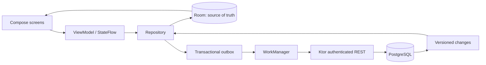
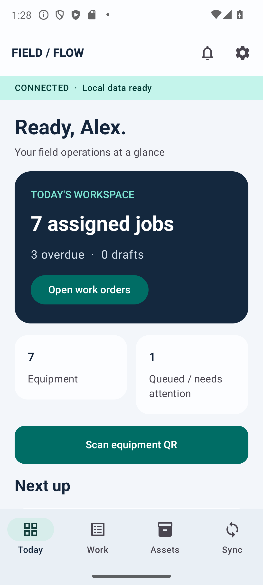
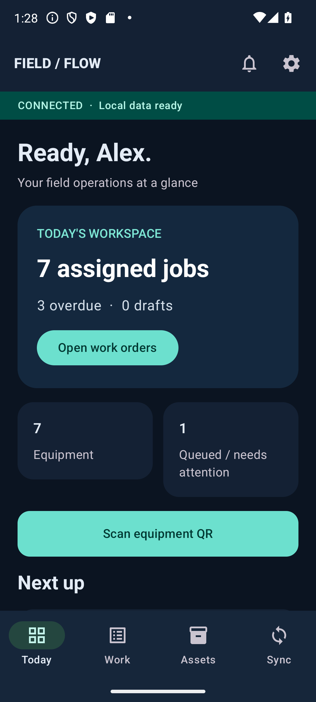

# FieldFlow

**Offline-First Field Service & Equipment Inspection**

FieldFlow is a technician-facing Android application for inspecting industrial equipment when connectivity is unreliable. It saves work to Room first, queues immutable submissions, and synchronizes with an authenticated Kotlin service backed by PostgreSQL.

The project contains a real Android application, a Ktor service, database migrations, shared domain rules, and automated tests. All people, accounts, equipment and locations are fictional.

## Capabilities

- Technician dashboard, assigned work directory, searchable equipment and inspection history.
- Data-driven checklists with pass/fail/N/A, yes/no, text, numeric ranges, comments and required photo evidence.
- Autosaved drafts, multiple severity-classified defects, private persistent photographs and explicit optional location capture.
- CameraX QR scanning with a bundled ML Kit model; manual entry and permission-denial fallbacks.
- Durable outbox, constrained WorkManager execution, exponential backoff, explicit failure and conflict records.
- Authenticated connected mode and a separately stored, entirely local demo.
- Material 3 light/dark themes, adaptive scrolling layouts, semantic status labels and in-app alerts.

## Repository

```text
app/                         Android application, Room schema and device/UI tests
backend/                     Ktor REST service, PostgreSQL migration and tests
shared/                      Serializable contracts, checklist rules, fictional seed
gradle/                      Version catalog and Gradle Wrapper
.github/workflows/ci.yml      Build, PostgreSQL integration and emulator jobs
docs/                        Architecture, API, demo and verification guides
docker-compose.yml           Local PostgreSQL with persistent volume
```

## Architecture



An inspection and its outbox operation are committed together. Retries reuse the same operation ID and frozen payload. PostgreSQL stores the receipt and inspection in one transaction. Conflicts retain the original local record and server snapshot; the technician can copy their answers to a distinct draft for review. Server downloads cannot replace unsynced inspections. See [architecture](docs/architecture.md).

## Build prerequisites

- JDK 17, Android SDK platform 35 and build tools 35.0.0 (minimum device API 26).
- Gradle 8.9 through the checked-in wrapper; Kotlin 2.1.21; AGP 8.7.2.
- PostgreSQL 16, or Docker Compose for the supplied service.
- Network access on the first build to resolve dependencies.

The toolchain follows the [AGP 8.7 compatibility table](https://developer.android.com/build/releases/agp-8-7-0-release-notes) and [Kotlin Gradle compatibility guidance](https://kotlinlang.org/docs/gradle-configure-project.html). Versions are intentionally pinned together, rather than tracking the newest plugin independently.

Lint is pinned independently to 8.8.2 because the Compose/Lifecycle checks require its analysis API, following the [official Compose lint guidance](https://developer.android.com/develop/ui/compose/tooling/lint).

Open the repository in Android Studio, select JDK 17, and let it create `local.properties`, or set `ANDROID_HOME` to your SDK directory. Do not commit machine-specific SDK paths.

```sh
./gradlew :app:assembleDebug
./gradlew :shared:test :app:testDebugUnitTest :backend:build
```

Windows PowerShell: use `.\gradlew.bat` in place of `./gradlew`.

Debug APK: `app/build/outputs/apk/debug/app-debug.apk`.

## Start PostgreSQL and the backend

Copy `.env.example` to `.env`. These are public, fictional local-development credentials, not deployment secrets. Docker Compose reads `.env`; a shell running Gradle must also export its values.

```sh
cp .env.example .env
docker compose up -d postgres
set -a; . ./.env; set +a
./gradlew :backend:run
```

PowerShell:

```powershell
Copy-Item .env.example .env
docker compose up -d postgres
Get-Content .env | Where-Object { $_ -match '^[A-Z_]+=' } | ForEach-Object {
    $name, $value = $_ -split '=', 2
    [Environment]::SetEnvironmentVariable($name, $value, 'Process')
}
.\gradlew.bat :backend:run
```

The backend also builds independently of the Android SDK: `./gradlew -p backend build` and `./gradlew -p backend run`.

Health: `GET http://localhost:8080/health`. Migrations run at startup. `SEED_DEMO=true` and `DEMO_PASSWORD` create fictional accounts once; subsequent runs do not reset passwords or duplicate records.

| Account | Development password when using `.env.example` |
|---|---|
| `alex@fieldflow.example` | `FieldFlow-Demo-2026!` |
| `riley@fieldflow.example` | `FieldFlow-Demo-2026!` |

To explore without the backend, choose **Continue as Alex Morgan** or **Continue as Riley Chen**. These buttons deliberately provide no authentication security. Demo data and submissions never upload.

## Android emulator

Boot an API 26+ Android emulator, then run:

```sh
adb install -r app/build/outputs/apk/debug/app-debug.apk
adb shell am start -n com.harshkatariya.fieldflow/.MainActivity
```

The debug client reaches the host backend at **`http://10.0.2.2:8080/api/v1/`**. A physical device requires an appropriate HTTPS endpoint and a build-time API URL change; release builds reject cleartext traffic. Only debug builds allow HTTP for emulator/loopback hosts. No cloud account is required.

## Tests and CI

```sh
./gradlew :shared:test :app:testDebugUnitTest :backend:test
./gradlew :app:connectedDebugAndroidTest
```

The first command is headless. The second requires a running emulator. Backend tests use a migrated relational H2 database for fast isolation and use real PostgreSQL when `TEST_DATABASE_URL`, `TEST_DATABASE_USER`, and `TEST_DATABASE_PASSWORD` are supplied. PostgreSQL coverage is reported as skipped when absent, never counted as passed.

GitHub Actions provisions PostgreSQL for its build job and an API 34 emulator in a separate UI-test job. Reports and the APK are uploaded as artifacts. See [testing and evidence](docs/testing.md) and [the reproducible demo](docs/demo-script.md).

## Screenshots

Captured from the initial application on an API 34 emulator (the current banner reads NETWORK AVAILABLE following the reliability fix):




See [screenshot capture notes](docs/screenshots.md) for the remaining capture plan.

## Security and operational boundaries

- Server passwords use BCrypt; server sessions are random opaque tokens stored as SHA-256 hashes, valid for seven days. Authenticated routes enforce work ownership.
- Android session material is encrypted using an Android Keystore AES-GCM key, stored outside backup. Passwords are never stored. Session recovery allows offline access until the original expiry, without extending it offline.
- Logout deletes the local session and cancels sync. It also attempts server revocation; an offline logout cannot revoke a token remotely. Technician-owned drafts and photos remain locally for later sign-in. Uninstall/app-data clearing removes them.
- The Room database and photos use Android application sandbox protection, not database-level encryption. This is a fictional-data portfolio application, not a regulated-data solution.
- Photo uploads are bounded, idempotent JPEG payloads stored durably in PostgreSQL. There is no paid storage service.
- No remote push delivery is implemented or claimed. In-app alerts derive from actual local work and sync state; FCM is an optional future extension.

## Limitations and future work

The current changes endpoint is a bounded full snapshot (1,000 work orders/inspections, 100 templates, latest 250 audits), suitable for the demo dataset. A production rollout should add cursor pagination, reassignment/tombstone handling, device management, server session cleanup, distributed rate limiting, retention policies, encrypted database storage where appropriate, release signing and HTTPS infrastructure. Cross-device inspection metadata is downloaded; remote photo rehydration into the local cache is not implemented. Photos captured on the current device remain available offline.

Conflict resolution preserves the original operation and creates a new draft; it does not merge conflicting answers or silently overwrite the server. Previously attached photos stay with the original record and must be recaptured for the new draft. Seed dates are fixed in UTC for deterministic demonstrations and naturally become overdue over time.

Hardware-dependent verification and any execution limitations are recorded in [testing](docs/testing.md). No deployment is included.
